  

<h1 align="center">🔍 Awesome Error Monitoring Platform</h1>

  <strong>Curated List of SaaS Products & Open-Source GitHub Projects</strong> 
  <em>Exception Tracking • Crash Reporting • Issue Grouping • Release Health • Session Replay • Developer-First Debugging</em>

  
  
  
  
  
  

---

## 📖 About

This repository tracks notable **SaaS platforms** and **open-source projects** for **Error Monitoring** (also called exception tracking or crash reporting). These tools automatically capture unhandled errors and exceptions, group them into actionable issues, provide stack traces and context, and help teams detect, triage, and fix problems across web, mobile, and backend applications.

**Examples** include Sentry, Rollbar, Bugsnag, Raygun, Honeybadger, Airbrake, LogRocket, Embrace, Instabug, Crashlytics, TrackJS, and GlitchTip (the category leaders).

**🌐 Open-source emphasis**: This section is heavily expanded with every major active project. Sentry itself offers a powerful self-hosted edition, and lightweight Sentry-compatible alternatives plus broader OpenTelemetry-based platforms make full data ownership practical for many teams.

> 🤝 Contributions welcome! Open a PR to add/update entries. Keep descriptions factual and link to official sites.

---

## 📑 Table of Contents

- 🏢 [SaaS/Hosted Platforms](#-saashosted-platforms)
- 💻 [Open-Source GitHub Projects](#-open-source-github-projects)
- 🤝 [How to Contribute](#-how-to-contribute)
- ⚠️ [Disclaimer](#-disclaimer)

---

## 🏢 SaaS/Hosted Platforms

📊 Sorted by company size (revenue/valuation) descending.

| Platform | Company Size | Pricing (Starting Tier) | Free Tier / Trial Limits |
|----------|-------------|------------------------|--------------------------|
| 🔥 **[Firebase Crashlytics](https://firebase.google.com/products/crashlytics)** | Part of Alphabet (Google) — $2T+ market cap, ~$340B annual revenue | Free for ≤50K sessions/mo; then $0.10 per 1K sessions (Pay-as-you-go) | ✅ Free forever: unlimited crashes, 50K sessions/mo, crash reporting, non-fatal events, custom logs, alerts |
| 🛡️ **[Sentry](https://sentry.io/)** | $217M total funding, est. ~$1B+ valuation, 200+ employees | Developer: Free; Team: **$26/mo** (annual); Business: **$80/mo** (annual) | ✅ Free forever (Developer plan): 1 user, 5K errors/mo, 5GB logs/mo, 5M spans/mo, 50 replays/mo, 10 dashboards, 1 uptime monitor |
| 🎬 **[LogRocket](https://logrocket.com/)** | $55M+ total funding (Series B), ~200 employees | Core: Free; Pro: Paid usage-based (above 100K sessions/mo) | ✅ Free forever (Core plan): 1,000 sessions/mo, error tracking, session replay, console logs, network requests |
| 🐛 **[Bugsnag (SmartBear Insight Hub)](https://www.bugsnag.com/)** | Part of SmartBear (acquired 2021); SmartBear owned by Francisco Partners — est. $100M+ revenue | Select: from **$0/mo** (usage-based); Preferred: from **$0/mo** (usage-based); Enterprise: custom | ✅ Free forever: 1 user, 7.5K events/mo, 1M spans/mo, 50+ platforms, basic notifications, full-stack diagnostics |
| 📱 **[Instabug / Luciq](https://www.instabug.com/)** | ~$50M+ total funding, ~100+ employees | Custom pricing based on Daily Active Users (DAU) & seats; contact for quote | ⏱️ No free tier — **demo/trial available on request**; enterprise-focused pricing with full platform access |
| 🎯 **[Raygun](https://raygun.com/)** | NZ-based, ~$10M+ total funding, ~50–100 employees | Basic: **$40/mo** (annual) per 100K errors; Team: **$80/mo** (annual) per 200K errors; Business: **$400/mo** (annual) per 1M errors | ⏱️ No free tier — **14-day free trial** with full feature access, unlimited apps and members, unlimited customer records |
| 📦 **[Rollbar](https://rollbar.com/)** | ~$26M total funding, ~50–100 employees | Essentials: usage-based (credits); Advanced: usage-based (credits); Enterprise: custom | ✅ Free forever: 5K occurrences/mo + 1K session replays/mo, real-time feed, intelligent grouping, stack traces, deploy tracking |
| 📲 **[Embrace](https://embrace.io/)** | ~$30M+ total funding, ~50 employees | Pro: **$0.80 per 1K sessions** (min $80/mo); Enterprise: custom | ✅ Free forever: up to 1M sessions/yr (~83K/mo), 5 users, errors & crashes, basic performance monitoring, 3-day data retention |
| 🐝 **[Honeybadger](https://www.honeybadger.io/)** | Bootstrapped & profitable, ~30–50 employees | Developer: Free; Team: **$26/mo**; Business: **$80/mo** | ✅ Free forever (Developer plan): 1 user, 5K errors/mo, 50MB/day perf & logging, 1 uptime monitor, 1 status page, 15-day data retention |
| ✈️ **[Airbrake](https://airbrake.io/)** | Acquired by PagerDuty (NYSE: PD) — ~$300M annual revenue (parent company) | Dev: **$19/mo** (monthly) for 25K errors; Basic: **$38/mo**; Pro: **$76/mo** | ⏱️ No free tier — **free trial** with unlimited errors, unlimited performance events, 30-day data retention during trial period |
| 📊 **[TrackJS](https://trackjs.com/)** | Bootstrapped, ~10–20 employees | Starter: **$49/mo** (100K page views); Professional: **$99/mo** (1M page views); Business: **$199/mo** (5M+ page views) | ⏱️ No free tier — **free trial** available; Starter includes 800K+ errors/mo, 10-day retention, unlimited users |
| ⚡ **[GlitchTip (Cloud)](https://glitchtip.com/)** | Small indie/open-source project, ~2–5 contributors | Small: **$15/mo** (100K events); Medium: **$50/mo** (500K events); Large: **$250/mo** (3M events) | ✅ Free forever: up to 1,000 events/mo, error tracking, unlimited projects, unlimited team members |
| 🤖 **[Runheed](https://runheed.com/)** | Small independent product from Great Work LLC | Solo: **$29/mo**; Pro: **$79/mo**; Scale: **$199/mo** | ⏱️ 7-day trial on every plan. SaaS. Groups errors from a Node or Python SDK and serves them over MCP, so a coding agent (Claude Code, Cursor, Codex) can read the stack trace, fix the bug and mark it resolved |

---

## 💻 Open-Source GitHub Projects

⭐ Sorted by GitHub stars (descending). Star badges link to each repo's stargazers page.

### 🏠 Error Tracking Platforms (Self-Hosted)

- **[Sentry (Self-Hosted)](https://github.com/getsentry/sentry)** 

  🏆 The open-source core of Sentry — a full-featured error tracking, performance monitoring, and session-replay platform that can be self-hosted. The most popular self-hosted error monitoring solution with broad SDK support.

- **[SigNoz](https://github.com/SigNoz/signoz)** 

  📈 Open-source, OpenTelemetry-native observability platform that includes error tracking alongside metrics, traces, and logs. A unified alternative to Grafana + Prometheus + Jaeger.

- **[Highlight.io](https://github.com/highlight/highlight)** 

  🔦 Open-source observability platform combining error monitoring, session replay, logging, and tracing in a single tool. Provides full-stack visibility for web applications.

- **[Errbit](https://github.com/errbit/errbit)** 

  🪤 Open-source error catcher that is API-compatible with Airbrake. Popular in Ruby/Rails environments as a lightweight self-hosted alternative.

- **[Uptrace](https://github.com/uptrace/uptrace)** 

  📍 Open-source APM powered by OpenTelemetry and ClickHouse. Provides distributed tracing, error monitoring, and log management with a built-in alerting system.

- **[GlitchTip](https://gitlab.com/glitchtip/glitchtip)** — *Hosted on GitLab* ⚡

  🪶 Lightweight, open-source, Sentry SDK-compatible error tracking system that is much easier to operate than full self-hosted Sentry. Supports Docker and bare-metal deployment.

- **[Bugsink](https://github.com/bugsink/bugsink)** 

  🐞 Minimalist, single-container, Sentry-compatible open-source error tracker designed for very low operational overhead. Focuses on simplicity and performance.

### 🔌 OpenTelemetry Ecosystem

- **[OpenTelemetry Collector](https://github.com/open-telemetry/opentelemetry-collector)** 

  🔧 Vendor-agnostic proxy that receives, processes, and exports telemetry data (traces, metrics, logs). Central to building custom error-monitoring pipelines.

- **[OpenTelemetry Collector Contrib](https://github.com/open-telemetry/opentelemetry-collector-contrib)** 

  🧩 Community-contributed receivers, processors, exporters, and extensions for the OpenTelemetry Collector. Extends the core with additional protocol support.

- **[OpenTelemetry JS](https://github.com/open-telemetry/opentelemetry-js)** 

  🌐 Official JavaScript/TypeScript SDK for OpenTelemetry. Auto-instruments Node.js and browser applications to capture traces, metrics, and logs.

- **[OpenTelemetry Proto](https://github.com/open-telemetry/opentelemetry-proto)** 

  📡 Protocol buffer definitions for OpenTelemetry. Defines the wire format used by all OTel components for traces, metrics, and logs.

### 📋 Log Aggregation & Distributed Tracing

- **[Grafana Loki](https://github.com/grafana/loki)** 

  📝 Horizontally scalable, multi-tenant log aggregation system inspired by Prometheus. Designed for cost-effective storage and querying of error logs and application logs.

- **[Jaeger](https://github.com/jaegertracing/jaeger)** 

  🔍 Open-source distributed tracing platform originally built by Uber. Collects and visualizes traces to help diagnose latency issues and root causes of errors.

### 🧰 Sentry SDKs (Open-Source)

- **[Sentry JavaScript SDK](https://github.com/getsentry/sentry-javascript)** 

  🟨 Official Sentry SDK for JavaScript and TypeScript. Supports browser, Node.js, React, Angular, Vue, and other frameworks with automatic error capture and performance instrumentation.

- **[Sentry Python SDK](https://github.com/getsentry/sentry-python)** 

  🐍 Official Sentry SDK for Python. Supports Django, Flask, FastAPI, Celery, and generic Python applications with automatic exception capture and performance tracing.

- **[Sentry PHP SDK](https://github.com/getsentry/sentry-php)** 

  🐘 Official Sentry SDK for PHP. Supports Laravel, Symfony, and generic PHP applications with error and performance monitoring.

- **[Sentry React Native SDK](https://github.com/getsentry/sentry-react-native)** 

  📱 Official Sentry SDK for React Native. Provides crash reporting, error tracking, and performance monitoring for iOS and Android React Native apps.

- **[Sentry Java SDK](https://github.com/getsentry/sentry-java)** 

  ☕ Official Sentry SDK for Java and Kotlin. Supports Spring Boot, Android, Logback, and generic JVM applications.

- **[Bugsnag Android SDK](https://github.com/Bugsnag/bugsnag-android)** 

  🤖 Official Bugsnag SDK for Android. Automatically captures Java/Kotlin crashes and errors with rich diagnostic data.

- **[Sentry Cocoa SDK](https://github.com/getsentry/sentry-cocoa)** 

  🍎 Official Sentry SDK for iOS, macOS, tvOS, and watchOS. Provides crash reporting and performance monitoring for Apple platforms.

- **[Sentry Go SDK](https://github.com/getsentry/sentry-go)** 

  🐹 Official Sentry SDK for Go. Supports standard error capturing, panic recovery, and performance tracing for Go services.

- **[Sentry Ruby SDK](https://github.com/getsentry/sentry-ruby)** 

  💎 Official Sentry SDK for Ruby. Supports Rails, Sinatra, and generic Ruby applications with automatic exception and performance capture.

- **[Bugsnag JS SDK](https://github.com/Bugsnag/bugsnag-js)** 

  🌐 Official Bugsnag SDK for JavaScript. Supports browser, Node.js, React, Vue, and other JS frameworks with automatic error capture.

- **[Sentry .NET SDK](https://github.com/getsentry/sentry-dotnet)** 

  🟣 Official Sentry SDK for .NET. Supports ASP.NET, MAUI, WPF, and generic .NET applications with crash reporting and performance monitoring.

- **[Sentry Rust SDK](https://github.com/getsentry/sentry-rust)** 

  🦀 Official Sentry SDK for Rust. Provides error capturing, panic handling, and performance tracing for Rust applications.

- **[Sentry Elixir SDK](https://github.com/getsentry/sentry-elixir)** 

  💧 Official Sentry SDK for Elixir. Supports Phoenix applications with automatic exception capture and performance monitoring.

- **[Sentry Native SDK](https://github.com/getsentry/sentry-native)** 

  ⚙️ Official Sentry SDK for native C/C++ applications. Provides crash reporting and error tracking for desktop, embedded, and game engine applications.

- **[Sentry Unity SDK](https://github.com/getsentry/sentry-unity)** 

  🎮 Official Sentry SDK for Unity game engine. Provides crash reporting and error tracking for Unity games on all platforms.

- **[Bugsnag Cocoa SDK](https://github.com/Bugsnag/bugsnag-cocoa)** 

  🍏 Official Bugsnag SDK for iOS and macOS. Automatically captures Objective-C/Swift crashes with detailed diagnostics.

### 🛠️ Additional Strong Open-Source Options

- **[Grafana](https://github.com/grafana/grafana)**  — 📊 Dashboarding and visualization platform. Essential for building custom error monitoring dashboards with Prometheus, Loki, and other data sources.

- **[Prometheus](https://github.com/prometheus/prometheus)**  — 📈 Monitoring and alerting toolkit with a dimensional data model. Commonly paired with alert rules for error-rate monitoring.

- **[Grafana Tempo](https://github.com/grafana/tempo)**  — 🚀 High-scale distributed tracing backend. Stores and queries traces collected via OpenTelemetry for error investigation.

- **[Grafana Pyroscope](https://github.com/grafana/pyroscope)**  — 🔬 Continuous profiling platform. Helps identify performance bottlenecks and resource-intensive code paths alongside error monitoring.

- **[OpenTelemetry Demo](https://github.com/open-telemetry/opentelemetry-demo)**  — 🎯 Full microservice demo application showcasing OpenTelemetry instrumentation for traces, metrics, and logs.

- **[Sentry CLI](https://github.com/getsentry/sentry-cli)**  — 💻 Command-line utility for managing Sentry projects — uploading source maps, releases, and debug symbols.

---

### 📌 Other Useful Patterns

- 🔄 Prometheus + Grafana alert rules combined with application logs for simpler error visibility.
- 📂 ELK/EFK or Loki stacks used as lightweight error aggregation layers.
- 🌍 Language-specific open tools (e.g., for Python, Node, Go) that provide structured exception reporting.
- 🤖 AI-assisted grouping and summarization experiments built on top of open error stores.

> **🏗️ Frameworks for building custom systems**: Instrument applications with official **Sentry SDKs** (or OpenTelemetry), point them at a self-hosted **Sentry**, **GlitchTip**, or **Bugsink** instance, and optionally layer **Highlight.io** or **SigNoz** for session replay and broader observability. This gives full ownership of error data while retaining modern issue workflows, source maps, and release tracking. Use standard SDKs wherever possible so switching backends remains simple.

---

## 🤝 How to Contribute

1. 🍴 Fork the repo.
2. ✏️ Add/edit entries in `README.md` (follow existing format).
3. 📝 Include: name, link, 1–2 sentence description, and whether it's SaaS or open-source.
4. 🚀 Submit PR with a short explanation.

> ⭐ Star the repo if you find it useful!

---

## ⚠️ Disclaimer

- 📋 This is a **community-curated** list — not exhaustive and not an endorsement.
- 🔐 Error monitoring often captures sensitive application data, stack traces, and sometimes user context. Self-hosted solutions provide excellent privacy and cost control but require proper security, scaling, backup, and maintenance.
- 📜 Always review data retention, PII handling, and compliance requirements (GDPR, etc.) before deploying any error tracking system in production.

---

## 📈 Star History

---

  <strong>🎯 Made for developers, SREs, and engineering teams that want reliable, transparent error visibility.</strong>  
  Let's make exception monitoring more open, affordable, and under your control.

